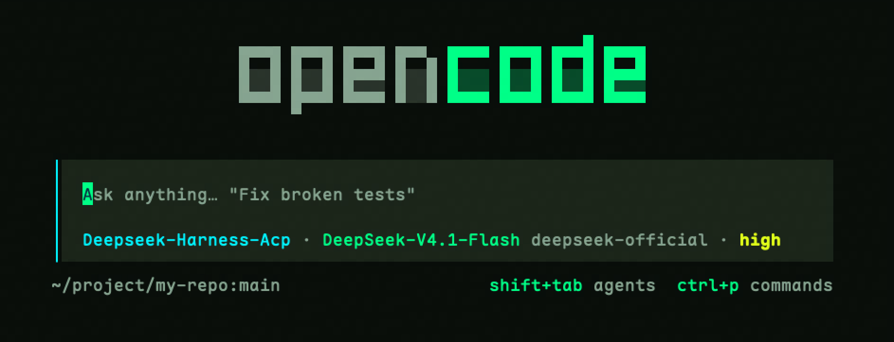
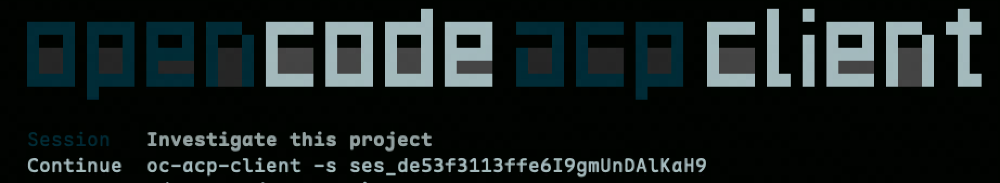

# opencode-acp-client

> 中文版：[README.zh.md](README.zh.md)



Use the **opencode v2 TUI** as the interface, driving **any ACP agent** (a terminal
**[ACP](https://agentclientprotocol.com) client**).

```
opencode v2 TUI ──HTTP + SSE──▶ opencode-acp-client ──ACP stdio──▶ any ACP agent
   (the interface)
                                  (the ACP client)
                                                                   dsh --profile acp /
                                                                   opencode acp / qwen --acp /
                                                                   claude-acp / codex-acp /
                                                                   gemini --acp / agy acp /
                                                                   pi-acp …
```

**Who it is for**: people who like the opencode v2 TUI — who have learned its keybindings, its
command palette, its session tabs — and want to keep using that interface while driving an agent
that is **not** opencode's own.

## Install

### 1. Install opencode v2 first

This tool **does not ship the TUI**; it drives an **opencode v2** you install yourself
(`>=2.0.0`; the latest release is recommended). **Skip this step if you already have it** (confirm
with `opencode --version` — it must be v2.x); otherwise, any one of:

```bash
curl -fsSL https://opencode.ai/v2/install | bash   # the official install script
npm install -g @opencode/cli                      # or npm (the package is @opencode/cli)
```

### 2. Install this tool

Needs **Node ≥ 20**.

```bash
# Option 1: from npm (recommended — you get a prebuilt package)
npm install -g opencode-acp-client

# Option 2: straight from source (point at the Git repository; npm fetches and builds it)
npm install -g git+https://github.com/pi-is314/opencode-acp-client.git
```

Two command names are installed, pointing at the same entry: **`opencode-acp-client`** (the
primary name) and **`oc-acp-client`** (a short alias).

When the TUI is not on `PATH`, point at it with `$OPENCODE_BIN`; the version is checked at
startup and reported rather than guessed.

## Use

```bash
oc-acp-client -- dsh --profile acp     # dsh's built-in ACP profile
oc-acp-client -- qwen --acp            # qwen-code
oc-acp-client -- opencode acp          # our bridge turns `opencode acp` back into opencode's own http protocol :)
```

The command after `--` is the agent; anything that speaks ACP over stdio works. One command
starts the TUI plus the adapter layer; quitting the TUI (or Ctrl-C) stops the agent too, leaving
no stray processes.

Beyond those, plenty of other agents implement ACP — for example
[gemini-cli](https://github.com/google-gemini/gemini-cli) (`gemini --acp`),
[Pi](https://github.com/badlogic/pi-mono) (through the [pi-acp](https://github.com/svkozak/pi-acp) adapter),
[GitHub Copilot](https://github.com/features/copilot),
[Kimi CLI](https://github.com/MoonshotAI/kimi-cli),
[Goose](https://block.github.io/goose/), [Cursor](https://cursor.com/docs/cli/acp),
[Kiro CLI](https://kiro.dev/docs/cli/acp/), [Cline](https://cline.bot/),
[OpenHands](https://docs.openhands.dev/openhands/usage/run-openhands/acp), and more.
**More ACP agents are listed here**: <https://agentclientprotocol.com/get-started/agents>.

**Resuming a session:**

```bash
opencode-acp-client -c                  # the most recent one in this directory
opencode-acp-client -s ses_xxxxx        # a specific session
```

`-s` / `-c` do **not** accept `--` with an agent command — which agent to use comes from the session map,
and the CLI starts it for you. Where do session ids come from? The `Continue` line printed when the TUI
exits has been rewritten into a command you can paste:



Alternatively:

```bash
python3 scripts/list-sessions.py            # the newest 20: id, age, title, directory
python3 scripts/list-sessions.py my-project # filter by title/directory/id substring
```

**One client serves one agent.** That is by design, not a gap: the model/provider belong to the
agent, and mixing two agents' tabs into one TUI is exactly where "the new tab shows the other
agent's models" came from. So the TUI's tab layout is isolated per agent
(`~/.opencode-acp-client/opencode/<agent-slug>/`), and a session belonging to another agent is
refused (`404`). `--` is for a **new** session only.

### Using opencode desktop

The desktop speaks the same HTTP API as the TUI, so it can talk to this bridge. Start one, then
point the desktop at it:

```bash
oc-acp-client --bridge-port 8765 . -- qwen --acp
```

It prints one line with the address it is serving — `http://127.0.0.1:8765` — and that is the server
to add in the desktop. From there it is ordinary desktop use: add the project, open a conversation.

**The bridge keeps running until you stop it.** It has no way of knowing the desktop closed, so
when you are done:

```bash
oc-acp-client ps            # what is running: pid, agent, directory, URL
oc-acp-client stop          # stop it (add <pid> or --all when there are several)
```

`stop` shuts the agent down with the bridge, so nothing is left behind.

**One bridge, one agent**, same as the TUI — two agents means two bridges on two ports, which is
also how the desktop shows them as two servers.

★ `--bridge-host 0.0.0.0` accepts connections from other machines and **has no authentication**;
keep the default `127.0.0.1` unless you know the network is trusted.

## Common options

| Option | Meaning |
|---|---|
| `<directory>` | the working directory (opencode's spelling; `--directory` / `-C` also forward to the TUI) |
| `-s <id>` / `--session <id>` | resume that session |
| `-c` / `--continue` | resume the most recent session in this directory |
| `--no-tui` | serve the HTTP/SSE surface only, without the TUI |
| `--bridge-port <n>` | serve on this port only (implies `--no-tui`) |
| `--bridge-log <path>` | where the bridge log goes |
| `$OPENCODE_BIN` | the opencode v2 binary |

**These are the only options that reach the TUI** (with opencode v2's own semantics, not ours):

| Option | How it reaches the TUI |
|---|---|
| `--auto` | forwarded verbatim (auto-approve permissions that are not explicitly denied) |
| `--prompt <text>` | forwarded verbatim (prefill the composer) |
| `--print-logs` | forwarded verbatim |
| `--log-level <level>` | forwarded verbatim |
| `-c` / `--continue` | forwarded verbatim — the TUI reads its own remembered session list |
| `-s <id>` / `--session <id>` | **the bridge resolves it first**: it accepts the `ses_…` you were shown, then hands the TUI a `--session` |

`--server` / `--standalone` are ours (the bridge *is* that server) — they are dropped, **not**
forwarded. Nothing else goes to the TUI: subcommands like `auth`, `plugin` and `upgrade` pass
straight through to the opencode **binary** instead (see below).

`--help` prints opencode v2's own help first, then this tool's section.

**Subcommands**: `models` / `api` / `session` go through the bridge (the answer belongs to the
agent you attached); the rest (`auth`, `plugin`, `upgrade`, `debug`, …) pass straight through to
opencode. `ps` lists the bridge processes this tool has started.

## Platforms and versions measured

The **whole gate** (typecheck, unit tests, the 52-probe OpenAPI check, and every real-TUI mode in
tmux) has run on **macOS** and on **Debian 12**: **v2.0.0, v2.1.0, v2.2.0, v2.3.0** on both,
plus intermediate releases such as v2.2.7 on macOS. Windows runs typecheck and the unit tests;
its TUI is not measured (no tmux). Sixteen releases are recorded one row each in
[docs/COMPAT-OPENCODE.md](docs/COMPAT-OPENCODE.md).

## Docs

- [docs/DETAILS.md](docs/DETAILS.md) — files it writes, what a resumed session looks like, design rules, known gaps
- [docs/ARCHITECTURE.md](docs/ARCHITECTURE.md) — the process model and one turn end to end
- [docs/PROTOCOL.md](docs/PROTOCOL.md) — the opencode v2 surface we implement
- [docs/ACP-MATRIX.md](docs/ACP-MATRIX.md) — the ACP method matrix, event variants, deliberate deviations
- [docs/ACP-COMPAT.md](docs/ACP-COMPAT.md) — the runtime capability degradation rules
- [docs/COMPAT-OPENCODE.md](docs/COMPAT-OPENCODE.md) — version policy and the per-release record
- [docs/SESSION-LIFECYCLE.md](docs/SESSION-LIFECYCLE.md) — sessions, the map, the resume paths
- [docs/DEVELOPMENT.md](docs/DEVELOPMENT.md) — development notes and the traps
- [AGENTS.md](AGENTS.md) — the entry point for developing this repository

## License

[Apache-2.0](LICENSE). This project launches the opencode v2 binary as a separate process and
talks to its published HTTP API; it **links no third-party source**, so the licence stands on its
own.
